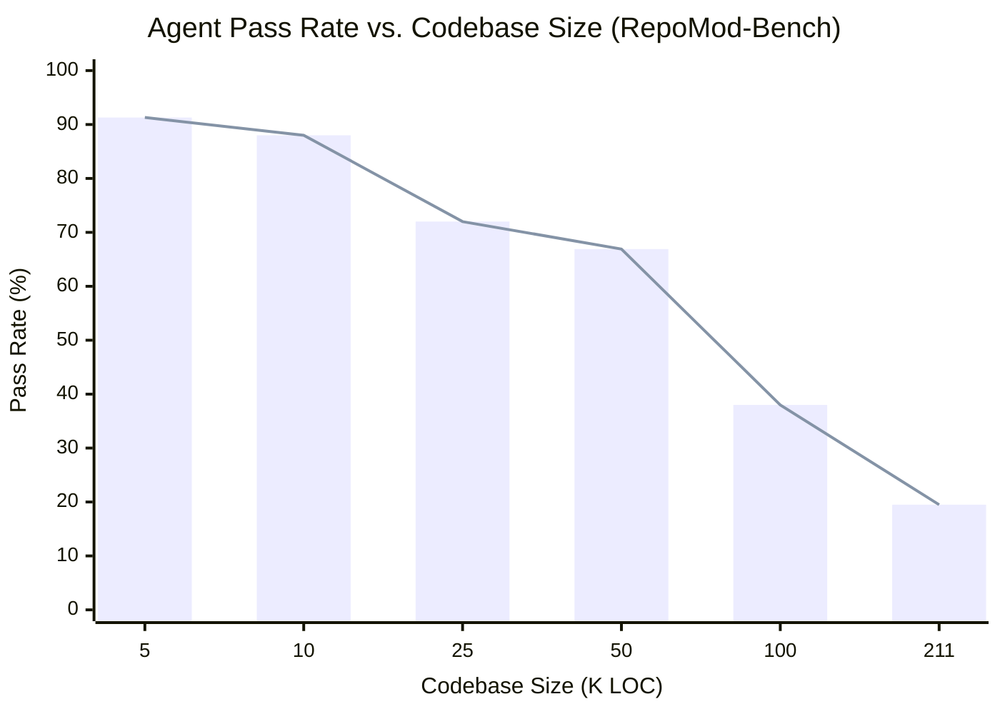
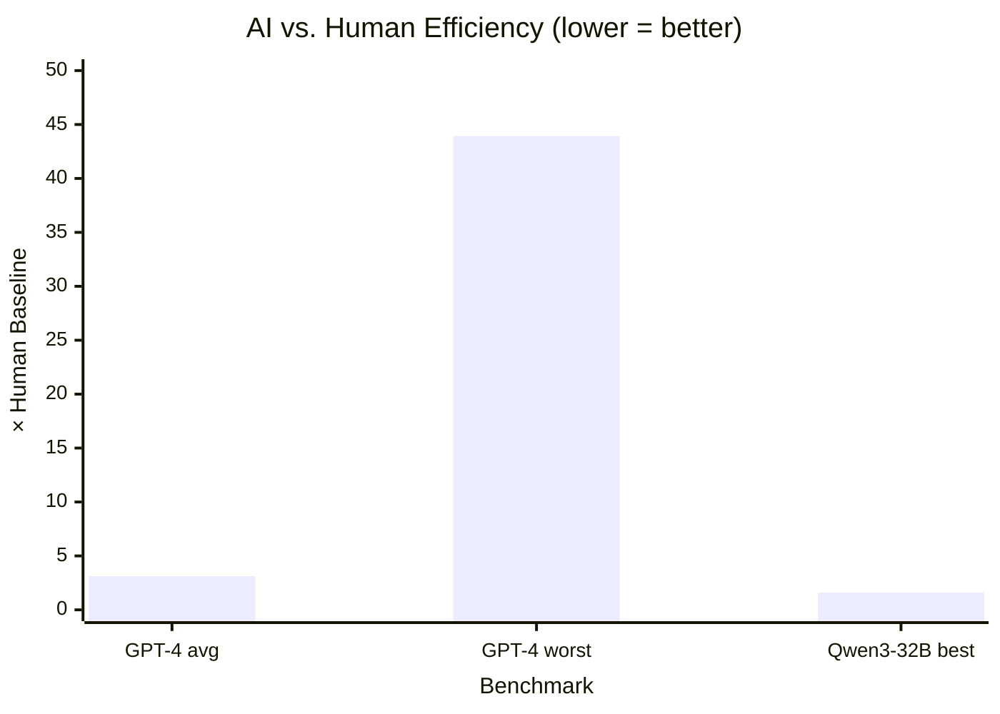
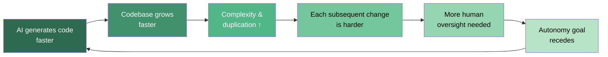
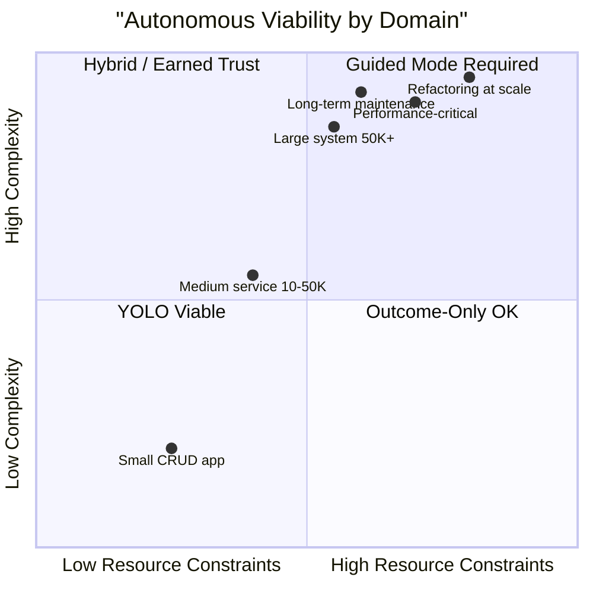
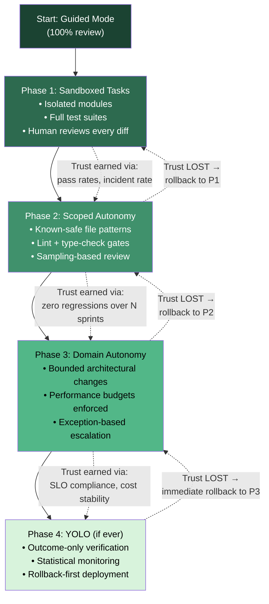

# AI Coding: The Case for Guided Autonomy
### An Evidence-Based Analysis

## Thesis

Autonomy in AI-assisted software engineering should be an **output** of a structured process — earned through boundaries, policies, sandboxes, and progressive trust — not an input assumed from the start. The "just check the outcome" paradigm works in a narrow band of low-complexity, resource-abundant tasks, but breaks down sharply as systems grow in size, performance sensitivity, or architectural complexity.

---

## 1. The Productivity Paradox

The strongest single data point: a randomized controlled trial of 16 experienced open-source developers on mature repositories (avg. 22K+ stars, 1M+ LOC) found that **AI tools made developers 19% slower**, while the developers *believed* they were 20% faster.

| Metric | Value |
|--------|-------|
| Actual effect | +19% completion time (slower) |
| Developer belief (pre-task) | Expected 24% speedup |
| Developer belief (post-task) | Still believed 20% speedup |
| Expert forecast (economics) | 39% faster |
| Expert forecast (ML) | 38% faster |

A February 2026 follow-up with the same developers confirmed an **18% slowdown** (CI −38% to +9%).

> **Source:** [METR RCT, July 2025](https://arxiv.org/abs/2507.09089) · [METR 2026 Update](https://metr.org/blog/2026-02-24-uplift-update/)

---

## 2. The Complexity Cliff (Scaling Collapse)

The marginal-gains argument is quantified by **RepoMod-Bench** (KDD 2026): 21 real repositories, 1.6M LOC, 11,616 tests, 8 languages.

| Repository Size | Average Agent Pass Rate |
|----------------|------------------------|
| < 10K LOC | **91.3%** |
| 10K–50K LOC | 66.9% |
| > 50K LOC | **15.3%** |
| 211K LOC (best agent) | 19.5% |
| 162K LOC (uncrustify) | 0% across all agents |

The degradation is **non-linear** — the authors explicitly call it a "scaling collapse." This is the quantitative boundary where "just check the output" stops being viable.

> **Source:** [RepoMod-Bench, arXiv 2602.22518](https://arxiv.org/html/2602.22518v1)

---

## 3. The Efficiency Gap

When resources are scarce (small containers, 2M records in memory, real-time constraints), the default AI solution is systematically suboptimal:

| Benchmark | Finding |
|-----------|---------|
| **EffiBench** (NeurIPS 2024) | GPT-4 code: avg **3.12× execution time**, worst case **13.89× time / 43.92× memory** vs. human SOTA |
| **EffiBench-X** (2025, 6 languages) | Best model (Qwen3-32B): only **~62% of human efficiency**; gap is *wider* in C++ and Go than Python |

This is precisely the domain where "outcome-only" evaluation fails: the code *works* but is too slow or too memory-hungry for the deployment target.

> **Sources:** [EffiBench, arXiv 2402.02037](https://arxiv.org/html/2402.02037v6) · [EffiBench-X, arXiv 2505.13004](https://arxiv.org/html/2505.13004v1)

---

## 4. The Maintainability Erosion (2022–2026)

GitClear's analysis of **623 million code changes** (2023–2026) shows a compounding degradation:

| Signal | 2022/2023 Baseline | 2026 | Δ |
|--------|-------------------|------|---|
| Moved/refactored code (% of changed lines) | 21% | 3.8% | **−70%** |
| Copy-pasted code (% of new code) | 9.4% | 15.7% | **+41%** |
| Duplicated blocks (per M changed lines) | 40.3 | 73.0 | **+81%** |
| Error-masking constructs | — | — | +47% |
| Cross-file function calls (reuse) | — | — | **−35%** |
| Legacy maintenance (code >12 mo old) | 1.7% | 0.46% | **−74%** |
| Two-week code churn | ~16% | ~19% | +15% |

```mermaid
xychart-beta
    title "Code Health Signals: 2022 vs. 2026 (GitClear)"
    x-axis "Metric" ["Refactored %", "Copy-paste %", "Duplication /M", "Legacy maint. %"]
    y-axis "Value" 0 --> 80
    bar [21, 9.4, 40.3, 1.7]
    bar [3.8, 15.7, 73.0, 0.46]
```

The implication: unguided AI generation is *accelerating* the accumulation of technical debt, making each subsequent change (including refactoring) harder.

> **Source:** [GitClear: The Maintainability Gap, 2026](https://www.gitclear.com/the_ai_code_quality_maintainability_gap)

---

## 5. Agent Code Is Harder to Maintain

A June 2026 study using the CodeThread framework found that agents perform **worse when building on agent-written code** than on human-written code, with resolve-rate drops of up to **13.1%**. The clearest signals are behavioral: changes to input validation, error handling, and downstream code size.

A companion study (May 2026, 3,238 commits) found that **83.21% of commits to AI-generated files are made by humans**, not agents — the "autonomous maintenance" narrative is not borne out by the data.

A follow-up (October 2026, 1,996 paired events) found that building on an agent's own history lowers its later-task resolution by **5.6 pp on average** (up to **14.0 pp** when all prior tests must pass) — a compounding self-degradation loop.

> **Sources:**
> - [Is Agent Code Less Maintainable Than Human Code? arXiv 2606.21804](https://arxiv.org/abs/2606.21804)
> - [To What Extent Does Agent-generated Code Require Maintenance? arXiv 2605.06464](https://arxiv.org/abs/2605.06464)
> - [Do Modifications Made by Coding Agents Make Subsequent Software Maintenance Harder? arXiv 2610.14768](https://arxiv.org/html/2610.14768v1)

---

## 6. Why Languages Aren't Dead & Why AI Doesn't Emit IL

Several structural reasons explain why source languages persist and direct IR generation is not a solved problem:

1. **LLMs are measurably worse at IR than source code.** IR is verbose, graph-structured, and outside the training distribution. Meta's LLM Compiler sidesteps this by generating *compiler pass lists* rather than IR, explicitly because "correctness verification plagues techniques that require the output of the model to be trustworthy."

2. **No single language covers all needs.** Systems programming, concurrency, query, hardware description, and theorem proving encode different semantics. The value of a language is shifting toward "cheap to run, easy to verify, hard to get wrong" — which is why strongly-typed languages (Rust, TypeScript) gain ground *because* AI works better with their constraints.

3. **Ecosystem gravity + training corpus lock-in.** A new language starts at near-zero model fluency — an adoption tax that didn't exist before AI.

4. **New paradigms are emerging.** The bottleneck has moved from "expressing a loop" to "defining what the loop should accomplish, under what constraints, with what error behaviors, and how to verify it." That's a *new* programming problem, not the absence of one.

> **Source:** [Meta LLM Compiler (Cummins et al., 2024), arXiv 2407.02524](https://arxiv.org/abs/2407.02524)

---

## 7. The Compounding Dynamic

The data reveals a **positive feedback loop of degradation**:

The velocity advantage of AI tools decays from ~281% (month 1) to ~0% (month 3) in adoption studies. PR review time in AI-heavy teams is up **441%** (DORA 2025). The system is not converging on "no human needed" — it's converging on "human needed more, in a different role."

> **Source:** [DORA Report 2025](https://dora.dev)

---

## 8. Synthesis: Where the Marginal Gain Lives

| Domain | Autonomous viability | Why |
|--------|---------------------|-----|
| Small CRUD app, abundant resources | **High** (91% pass rate) | Outcome ≈ correctness; efficiency irrelevant |
| Medium service (10–50K LOC) | **Moderate** (67%) | Architecture matters; some guidance needed |
| Large system (>50K LOC) | **Low** (15%) | Scaling collapse; cross-cutting concerns dominate |
| Performance-critical / low-resource | **Very low** (62% human efficiency) | Default solutions are 3–14× too slow; domain knowledge required |
| Refactoring / modernization at scale | **Very low** (0–19.5%) | Agents fail; compounding self-degradation |
| Long-term maintenance | **Human-dominant** (83% human commits) | Agents degrade on their own history |

**The threshold is not arbitrary.** It sits at the intersection of codebase size (~10–50K LOC), resource constraints, and architectural coupling — exactly where the data shows the cliff.

---

## 9. The Path to Earned Autonomy

> **Autonomy is an output, not an input.** Each phase is entered by evidence, not by calendar.

---

## 10. Conclusion

The "you won't need to understand code in a few years" position extrapolates from the 91%-pass-rate zone and ignores the 15% zone. The evidence across five independent research programs (METR, RepoMod-Bench, EffiBench, GitClear, and the 2026 maintainability studies) converges on a single finding:

> **Code understanding is not being eliminated — it is being concentrated.** The role shifts from writing every line to *judging* which lines matter, *where* the efficiency cliff is, and *whether* the architecture will survive the next refactor. That is a harder skill than typing, not an easier one.

Autonomy is an output. The process that earns it — boundaries, policies, sandboxes, progressive trust — is the actual engineering work.

---

## References

| # | Source | Link |
|---|--------|------|
| 1 | METR RCT (July 2025) | [arXiv:2507.09089](https://arxiv.org/abs/2507.09089) |
| 2 | METR 2026 Follow-up | [metr.org](https://metr.org/blog/2026-02-24-uplift-update/) |
| 3 | RepoMod-Bench (KDD 2026) | [arXiv:2602.22518](https://arxiv.org/html/2602.22518v1) |
| 4 | EffiBench (NeurIPS 2024) | [arXiv:2402.02037](https://arxiv.org/html/2402.02037v6) |
| 5 | EffiBench-X (2025) | [arXiv:2505.13004](https://arxiv.org/html/2505.13004v1) |
| 6 | GitClear: The Maintainability Gap (2026) | [gitclear.com](https://www.gitclear.com/the_ai_code_quality_maintainability_gap) |
| 7 | Is Agent Code Less Maintainable Than Human Code? (2026) | [arXiv:2606.21804](https://arxiv.org/abs/2606.21804) |
| 8 | To What Extent Does Agent-generated Code Require Maintenance? (2026) | [arXiv:2605.06464](https://arxiv.org/abs/2605.06464) |
| 9 | Do Modifications Made by Coding Agents Make Subsequent Maintenance Harder? (2026) | [arXiv:2610.14768](https://arxiv.org/html/2610.14768v1) |
| 10 | Will It Survive? AI-Generated Code in Open Source (2026) | [arXiv:2601.16809](https://arxiv.org/html/2601.16809v1) |
| 11 | Not All Agents Are Equal: Post-Merge Maintenance (2026) | [arXiv:2609.17598](https://arxiv.org/html/2609.17598) |
| 12 | DORA Report 2025 | [dora.dev](https://dora.dev) |
| 13 | Meta Large Language Model Compiler: Foundation Models of Compiler Optimization (Cummins et al., 2024) | [arXiv:2407.02524](https://arxiv.org/abs/2407.02524) |

---

*Generated: November 7, 2026*
