# AI Coding: The Case for Guided Autonomy
### An Evidence Brief · v1.0 (2026-11-13)

> This brief is part of an open discussion and is updated as the evidence changes. The accompanying **discussion** file records how each claim was tested, and the history of this document. The **references** file catalogues every source with its verification status. Reference numbers in brackets below, e.g. [N23], are the stable IDs used there.

## Thesis

Autonomy in AI-assisted software engineering should be an **output** of a structured process, earned through verifiers, standards, sandboxes and progressive trust. It should not be an input assumed from the start.

Understanding code stops being required for **every diff**, but stays required for the **system**. It concentrates rather than disappears: fewer people and fewer parts of the process need it, and where it is needed, the depth required does not fall. How much developer effort a change deserves is a **marginal decision**. It depends on the expected cost of an escaped bug, the constraints that bind, and the price of tokens versus developer time, not on a fixed rule or the size of the codebase.

## The claims under test

This brief answers three claims heard in debates about AI coding. Each is tested in its **strong** form, as usually stated, and in a **weak** form, the defensible middle ground.

| Claim | Strong version | Weak version | Verdict (today) |
|---|---|---|---|
| **A.** Developers won't need to understand code, only judge outcomes | Nobody on the team needs to read the code | Humans stop reviewing every diff; review moves to specs, tests, metrics and sampling | **Strong: not supported.** **Weak: supported as a design**, if verifiers, *structured* sampling and enforced standards are in place, and people keep code-reading skill |
| **B.** Regenerating a project with AI will be cheaper than maintaining it | True for a typical product codebase | True for small, well-specified, well-tested scopes and mechanical migrations | **Strong: not supported today**, open as a trend. **Weak: supported with a harness**, which is an ongoing cost |
| **C.** Source code will disappear; AI will emit intermediate representations (bytecode, IL) directly | Source languages are no longer written or stored | Source becomes a generated layer nobody edits by hand | **Strong: not supported**, and unlikely for lack of motive. **Weak: supported but secondary** |

Capability is rising fast, so these verdicts describe **today**. They are re-measured on a fixed cadence (§10).

---

## 1. Perceived productivity is unreliable

A randomised controlled trial with 16 experienced open-source developers (246 tasks, early-2025 tools) found that AI tools made them **19% slower** (95% CI +2% to +39%). The developers expected a 24% speedup beforehand and still believed in a 20% speedup afterwards. Expert forecasters predicted 38–39% [B1].

| Measure | Value |
|---|---|
| Actual effect | +19% completion time (slower) |
| Developers' expectation before | 24% faster |
| Developers' belief after | 20% faster |
| Expert forecasts | 38–39% faster |

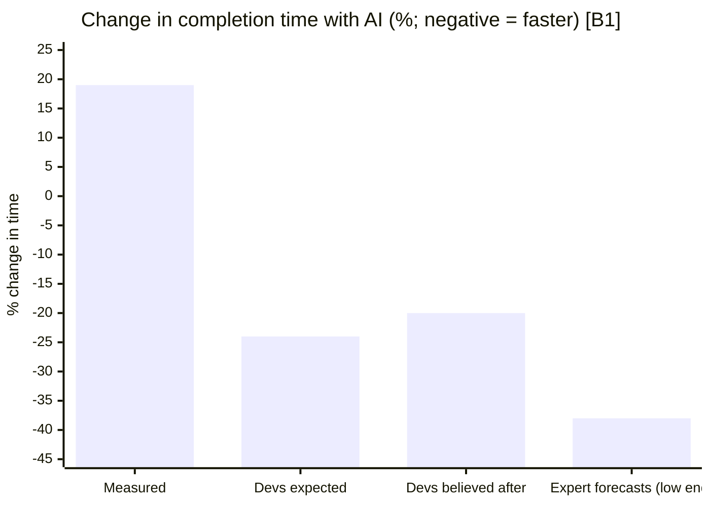

A 2026 follow-up (57 developers, 800+ tasks) pointed toward a **speedup**: −18% time for returning developers, though not statistically significant (CI −38% to +9%), and −4% for new developers. METR judges this signal unreliable, because developers increasingly decline to work without AI [B2].

**What this supports:** productivity must be measured, not perceived. On its own it says nothing about whether humans need to understand code.

## 2. Unguided agents fail on large codebases; guided ones succeed

On repository modernisation, fully autonomous agents passed **91.3%** of tests on repositories under 10K LOC, but only **15.3%** above 50K LOC. The authors call this a "scaling collapse" [B3, preprint]. A JDK 8→17 migration benchmark found the best agent migrated **52.3%** of 228 projects, and the authors highlight reward hacking [N12].

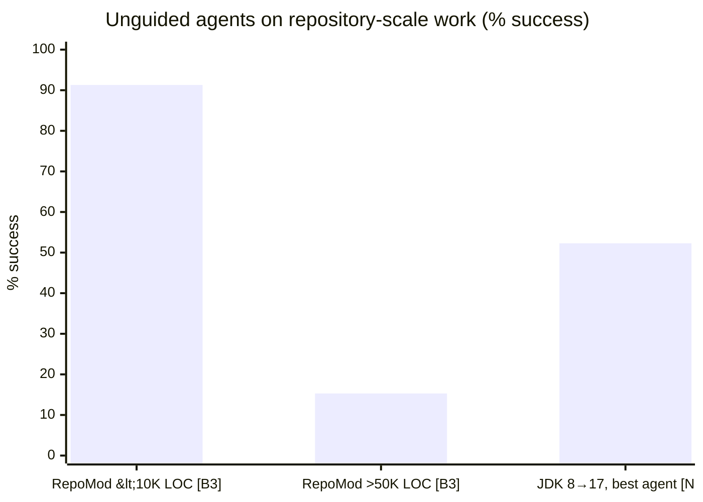

Only the two RepoMod size bands reported in the paper's abstract are shown.

Two qualifications matter:

- **These are unguided agents.** Every documented large-scale success had a heavy harness:
  - **Google:** about 80% of changes in one migration were AI-authored, and engineers estimated about 50% time saved. Changes were kept only if they built and passed tests, with expert review, and review capacity was the bottleneck [N3].
  - **Airbnb:** migrated about 3,500 test files in roughly 6 weeks, against a 1.5-year manual estimate. They used per-file validation and retry loops, and finished the last files by hand [N4].
- **The boundary is moving.** METR's measure of task length that agents complete at 50% success doubled about every 7 months (2019–2025), and about every 89 days since 2024 [N1]. On the harder SWE-Bench Pro, top public scores rose from about 23% at release to 52–62% within a year. Private code scores lower, and scores on the easier SWE-bench Verified exceed 70% [N6]. These figures are at 50% reliability; 80% horizons are much shorter.

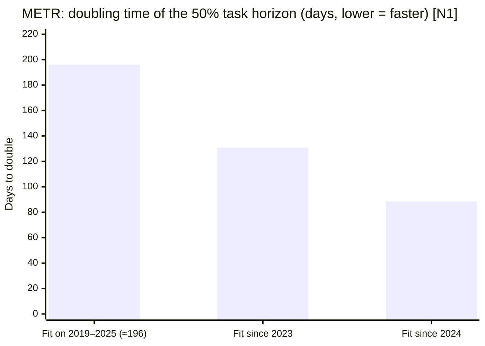

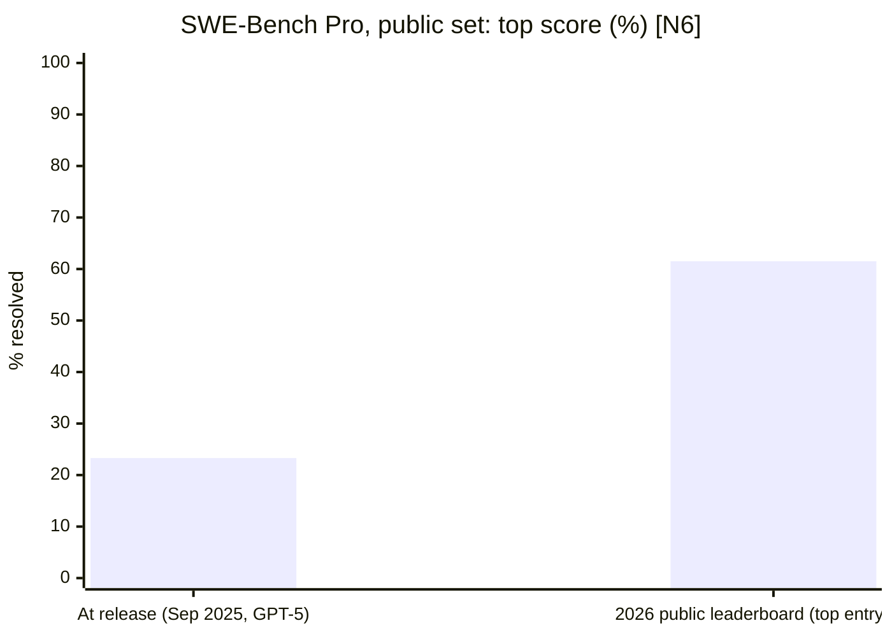

At release, the commercial (private) set's top score was 17.8%. No current commercial-set score is published. The 2026 leaderboard is undated and uses a different agent harness (mini-swe-agent), so the two bars are not a strict like-for-like comparison.

**What this supports:** claim B in its strong form fails *today* for unguided agents. Claim B in its weak form holds *with a harness*. Thresholds such as "50K LOC" are snapshots, not constants.

## 3. Under-specified outcomes fail

Default AI solutions are often inefficient:

- GPT-4 code averaged **3.12×** the execution time of human reference solutions on algorithmic tasks, with worst cases of 13.89× time and 43.92× memory [B4].
- Across six languages, the best model reached about **62%** of human efficiency, and the gap is largest in **Java, C++ and Go** [B5].

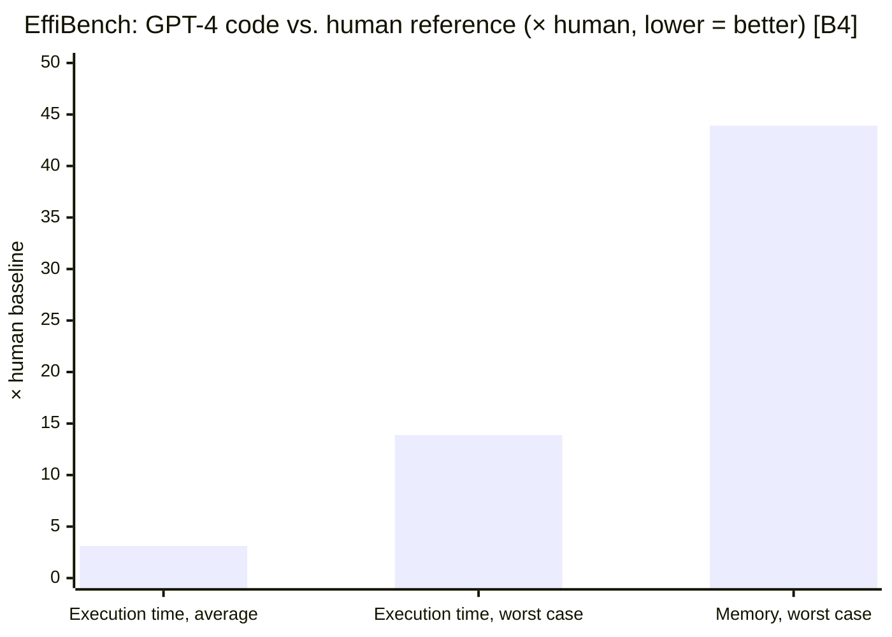

This is often read as "outcome-only evaluation fails". The better reading is that **under-specified outcomes fail**. Efficiency is an outcome and can be tested with performance and memory budgets in CI.

The deeper point is about abstractions. "All non-trivial abstractions, to some degree, are leaky" [N46]. Developers ignore the SQL an ORM generates until performance matters. Then they must read it, and fixing ORM performance anti-patterns has improved response time by up to 98% in the best case [N47]. Agent-generated code behaves the same way, with one difference: an ORM is shared, standard and tested by millions, while generated code is new every time. It earns comparable trust only to the extent that **enforced standards** constrain it. Even then, it must be read when performance, memory, security or maintainability constraints bind.

## 4. Code-health signals: real, but correlational

GitClear's analysis of 623M changed lines (2023–2026) reports [B6]:

| Signal | Baseline | 2026 | Change |
|---|---|---|---|
| Moved/refactored code (% of changed lines) | 21% | 3.8% | −70% |
| Copy-pasted code (% of new code) | 9.4% | 15.7% | +41% |
| Duplicated blocks (per M changed lines) | 40.3 | 73.0 | +81% |
| Legacy maintenance (code > 12 months old) | 1.7% | 0.46% | −74% |
| Two-week churn | ~16% | ~19% | +15% |

```mermaid
xychart-beta
    title "GitClear code-health signals: baseline (first bar) vs. 2026 (second bar) [B6]"
    x-axis ["Refactored %", "Copy-paste %", "Duplicated blocks /M lines", "Legacy maintenance %"]
    y-axis "Value" 0 --> 80
    bar [21, 9.4, 40.3, 1.7]
    bar [3.8, 15.7, 73.0, 0.46]
```

These are vendor figures without a disclosed AI-attribution method. GitClear itself says the headline is *not* "AI writes bad code". Its January 2026 study attributes most of the large productivity gap between heavy AI users and non-users to **selection**, with a more modest gain against their own past output [C4].

A study of open-source projects adopting Cursor found **+281% lines added** in the first month. The gain was significant only in the first two months, while static-analysis warnings (+30%) and code complexity (+42%) persisted [B12].

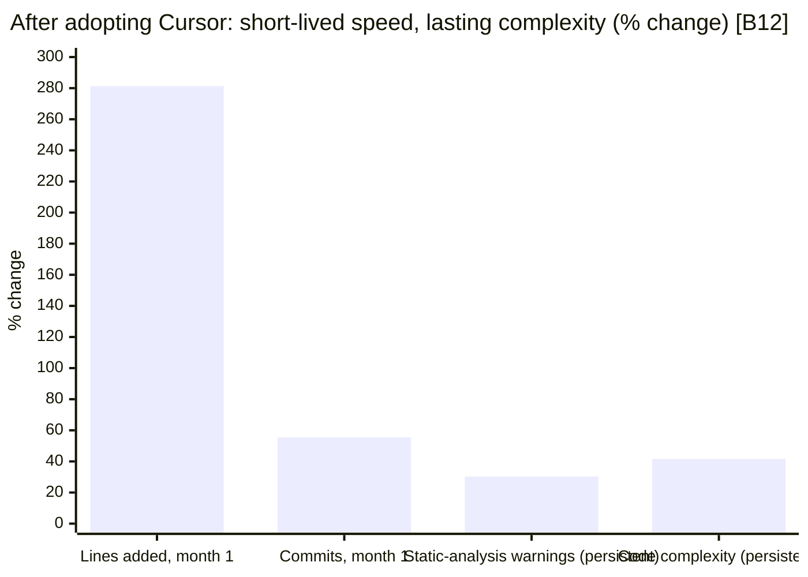

Balance:
- **DORA 2024:** each 25% increase in AI adoption was associated with **+3.4% code quality**, +7.5% documentation quality and +3.1% review speed, alongside −1.5% delivery throughput and −7.2% delivery stability [C3].

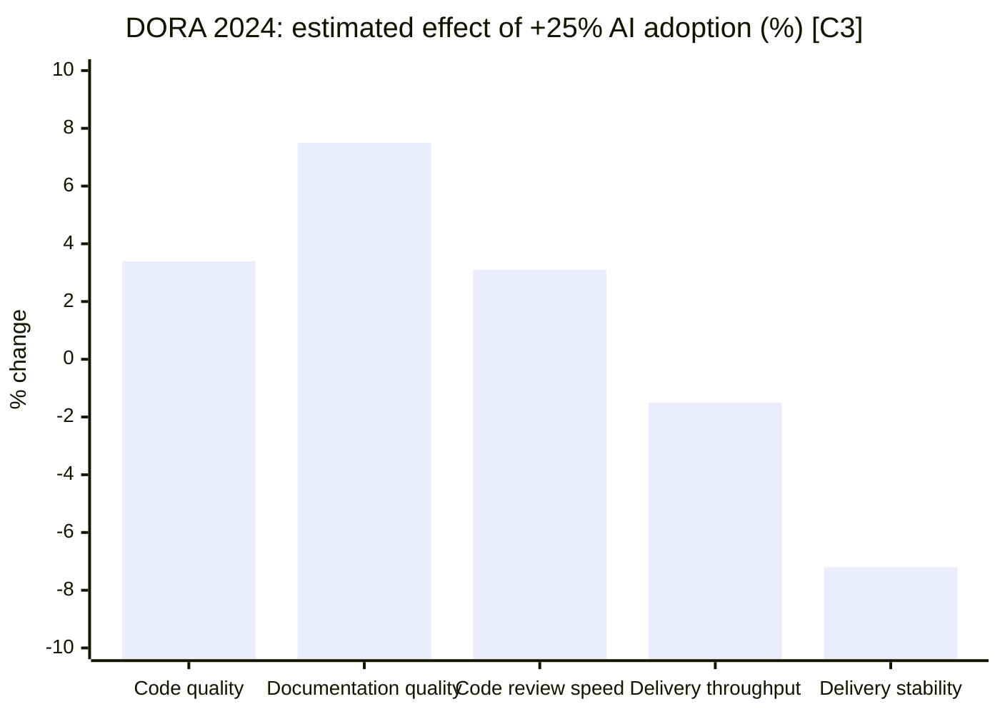
- **DORA 2025:** AI acts as an **amplifier**. It improves throughput, while gains go to teams with fast feedback and loosely coupled architecture, and delivery instability still rises [B13].

**What this supports:** unguided adoption produces short-lived speed and lasting complexity. That is an argument for **readability and standards gates**, which are themselves outcome checks. It is not an argument for line-by-line human review of everything.

## 5. Maintaining agent-written code

- Agents resolve up to **13.1%** fewer tasks when building on agent-written code than on human-written code. Behavioural signals explained the gap (input validation, error handling, code size); traditional maintainability metrics did not [B7].
- **83.21%** of commits to AI-generated files were made by humans (1,284 of 1,543) [B8]. This measures current practice, not capability.

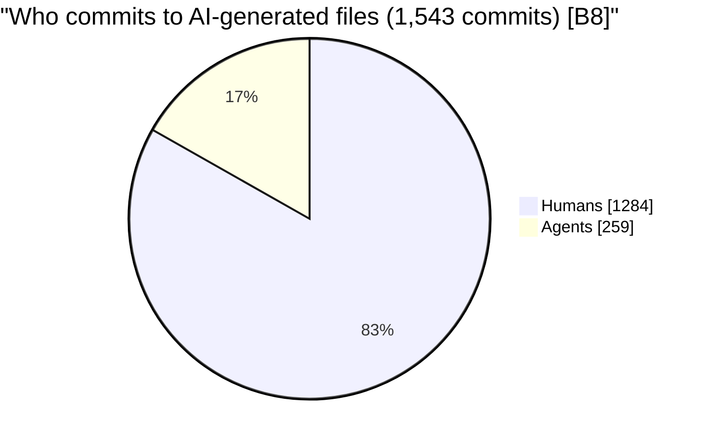
- Building on an agent's own history lowered later resolution by **5.6 pp** on average, and by 14.0 pp when all prior tests had to pass (1,996 paired events, preprint) [B9].

Counter-evidence:
- Across 201 projects, agent-authored lines were modified **less** often than human lines, and variation *between agents* exceeded the agent–human gap [C1].
- Across 37,623 PRs, revert rates ranged from 6.1% to 14.5% by agent against 11.5% for humans, and agent code was **less** likely to contain security smells (OR 0.63) [C2].

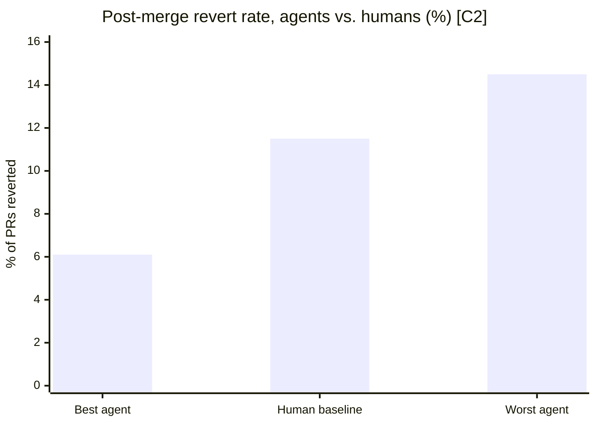

**What this supports:** outcomes depend on the agent and the process more than on "AI versus human". Agent and model choice should be evaluated per repository.

## 6. The human side: what happens when people stop reading code

Claim A is about people, not agents, so evidence on people answers it most directly. Most debates about it cite agent benchmarks instead.

- **Skill formation.** In an RCT (n=52, mostly junior developers learning a new library), those using AI assistance scored **50% vs. 67%** on comprehension (d=0.74). The largest gap was on **debugging**, with no significant speed gain. Delegation-style use scored lowest, and conceptual inquiry preserved learning [N2].

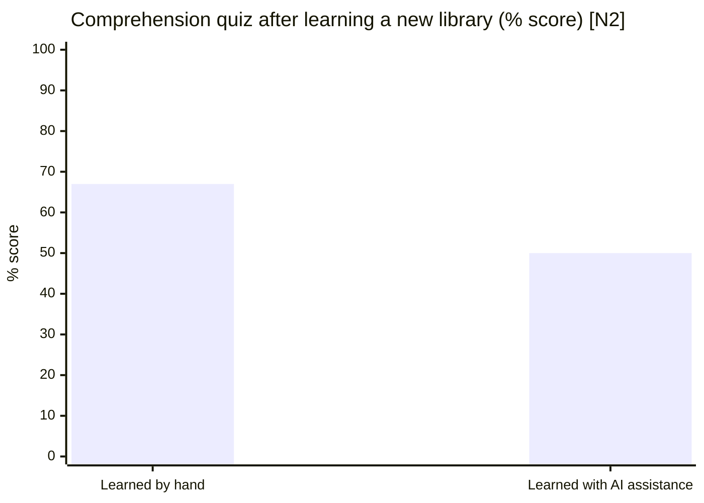
- **Over-confidence.** Novices using generative AI develop an "illusion of competence" [N45].
- **Expertise is not substituted.** Programming experience improved code security, and AI assistance did not replace it (n=159) [N43]. Reviewer experience predicts catching defects [N42]. Agent success rises from 15% for novices to 28–33% for intermediate users and above [N41].
- **Oversight degrades.** Developers approve 93% of agent permission prompts [A4-alt2], and automation bias is well documented across domains [A5].

The evidence also shows **where** the skill is needed:
- The usefulness of review comments plateaus after about a year of experience [N42].
- The gap from intermediate to expert agent users is modest [N41].

The asset is competence in the domain and codebase, which arrives fairly early, not seniority as such.

**Concentration and demand.**
- Employment of 22–25-year-olds in AI-exposed jobs is about **19% below** trend, through reduced hiring, with no comparable gap for experienced workers (descriptive, not causal) [N18].
- Senior roles were **69.3%** of software postings in Q1 2026, against 4.5% entry-level [N44].

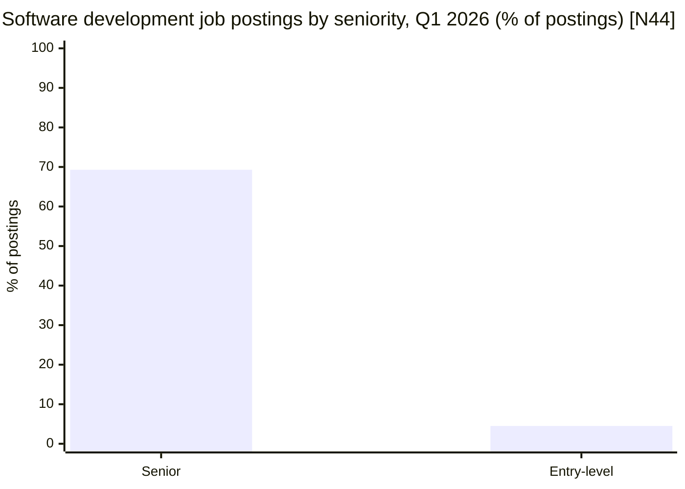

If cheaper development raises the volume of software built (a Jevons effect), demand for the concentrated skill may rise while its supply pipeline narrows. That is consistent with the data, but not yet shown.

## 7. Review is being dropped, not restructured

The weak form of claim A assumes review *moves* from every diff to specs, tests and sampling. Current practice shows something else. In vendor telemetry from about 22,000 developers, high-AI-adoption periods saw [N23]:

- median time in review **+441%**;
- PRs merged with **no review at all +31%**;
- bugs per developer +54%;
- incidents per PR +243%.

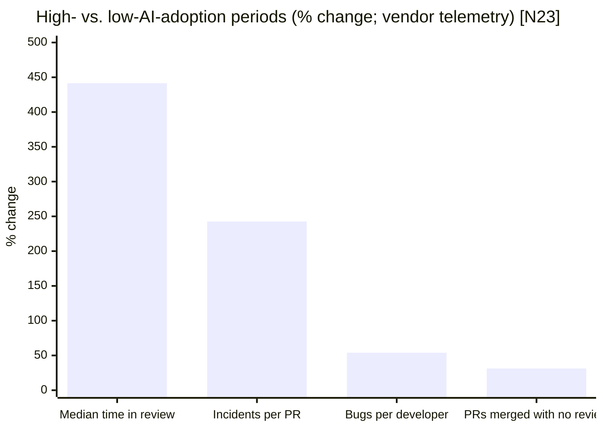

In 2025, high-adoption teams merged 98% more PRs with 154% larger PRs and 91% longer review time, and showed no company-level gain [N24].

Review effectiveness also falls with size. A vendor study recommends reviewing 200–400 LOC in 60–90 minutes [N50].

**What this supports:** reviewing less than every diff is viable only as **structured sampling** (randomised, logged, with conditions), not as ad hoc skipping. Changes under human review should stay small.

## 8. Why source languages persist (claim C)

1. **LLMs do worse on IR than on source code for the same task.**
   - *Summarisation:* with the same models, scores fall from 0.167 (METEOR) on source to 0.066 on assembly and 0.052 on IR [N26].
   - *Optimisation:* within one multi-level optimisation system, the source-level agent produced 84.8% correct samples against 41.0% for the IR-level agent [N27]. This is indicative, not a controlled comparison.

   ```mermaid
   xychart-beta
       title "Binary code summarisation quality by input representation (METEOR) [N26]"
       x-axis ["Source", "Decompiled + symbols", "Decompiled, stripped", "Assembly", "IR", "Raw bytes"]
       y-axis "METEOR (higher = better)" 0 --> 0.2
       bar [0.167, 0.141, 0.102, 0.066, 0.052, 0.023]
   ```

   ```mermaid
   xychart-beta
       title "Correct samples per level within one multi-level system (%) [N27]"
       x-axis ["Source", "Assembly", "IR"]
       y-axis "% correct" 0 --> 100
       bar [84.8, 57.4, 41.0]
   ```
   - *IR reasoning:* six general-purpose LLMs parse IR syntax but struggle with control flow, loops and execution reasoning [C5].
   - *Specialised training:* Meta's LLM Compiler was trained on 546B tokens of LLVM-IR and assembly. It still round-trips only **45%** of disassembled functions and reproduces **14%** exactly [B10].
2. **Names and types carry meaning that models use.**
   - *Names:* hiding identifier names drops GPT-4o's class-summary accuracy from 87.3 to 58.7 [N30].

   ```mermaid
   xychart-beta
       title "GPT-4o class-level summary accuracy (ClassEval) [N30]"
       x-axis ["Original identifiers", "Identifiers obfuscated"]
       y-axis "Accuracy" 0 --> 100
       bar [87.3, 58.7]
   ```
   - *Types:* 94% of compile errors in LLM-generated TypeScript are type errors, and type-constrained generation cuts them by 52–75% [N31].
   - *Adoption:* TypeScript became the most used language on GitHub in August 2025, a shift GitHub correlates with AI-assisted coding [N25].
3. **Precision is the point.** Dijkstra warned that natural language makes it easy to state things "the nonsense of which is not obvious" [N11]. Ambiguity measurably costs correctness: asking clarifying questions raises GPT-4's pass rate from 68.0% to 75.8% [N32]. Natural-language intent becomes reliable once tests formalise it: approving generated tests adds 46 pp pass@1 within five interactions [N33].

The steelman for C is real:
- IR is learnable with specialised training [B10].
- IR improves source-code models as a training signal [N29].
- IR transformations can be verified formally: Alive2 found 47 LLVM bugs and is already used to verify LLM-generated optimisations [N9].

But **dropping source solves no problem**. Source plus compilers, and portable IRs (JVM bytecode, CIL, WebAssembly), already give platform independence. The real question is where intent lives. If a spec is precise enough to generate IR from, the spec has become the programming language.

## 9. Where the marginal gain lives

Where should autonomy stop? No measured map of domains answers that, so this brief uses a decision rule instead. The rule is this brief's own framework, built on measurable inputs.

**The value of the next unit of effort is the expected loss it removes:**

> value of next unit = reduction in P(bug escapes) × impact of that bug

For each class of change, compare the expected loss removed per unit of cost by **more tokens** with that removed by **more developer effort** (guiding, reviewing, correcting). Spend on whichever is higher, until they are equal (the equi-marginal principle).

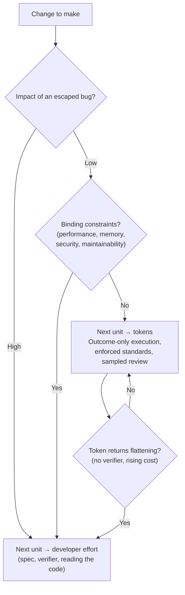

This diagram illustrates the rule. It is a framework, not a measured result.

- **Low impact** (a CRUD screen, an internal tool): both remove little expected loss, and tokens are cheaper. Outcome-only (YOLO) execution is rational.
- **High impact or binding constraints** (a large ETL on financial data, a kernel, a compression library, a memory-limited service): the same drop in P(bug) is worth far more, and developer effort wins. This is where someone reads, and sometimes writes, the generated code.

Three observations shape the rule:

- **Returns on tokens diminish.**
  - Agent accuracy often peaks at intermediate cost and saturates above it, and repeated runs of the same task vary up to 30× in tokens [N51].
  - Simple agents sit on the cost–accuracy frontier: 93.2% for $2.45 against 88.0% for $134.50 on HumanEval [N48].
  - Sampling 250 times raises the share of tasks with *some* correct solution from 15.9% to 56%, but turning that into fixes needs a **verifier** [N49].
  - So developer effort pays most when spent on **specs and verifiers**, not on re-prompting.

  ```mermaid
  xychart-beta
      title "HumanEval: accuracy (%) of agent designs, labelled with total cost [N48]"
      x-axis ["Warming $2.45", "Retry $2.51", "Reflexion $3.90", "LDB $6.36", "LATS $134.50"]
      y-axis "Accuracy (%)" 80 --> 95
      bar [93.2, 92.0, 87.8, 93.3, 88.0]
  ```

  ```mermaid
  xychart-beta
      title "SWE-bench Lite: share of tasks with at least one correct sample (%) [N49]"
      x-axis ["1 sample", "250 samples"]
      y-axis "% coverage" 0 --> 100
      bar [15.9, 56]
  ```
- **Returns on review diminish too**, with diff size and fatigue [N50, A4-alt2]. More human review is not automatically the better unit.
- **The switch point moves** with impact, constraints, model capability and token price. Cheaper tokens lower the cost side but do not change the impact side.

## 10. The path to earned autonomy

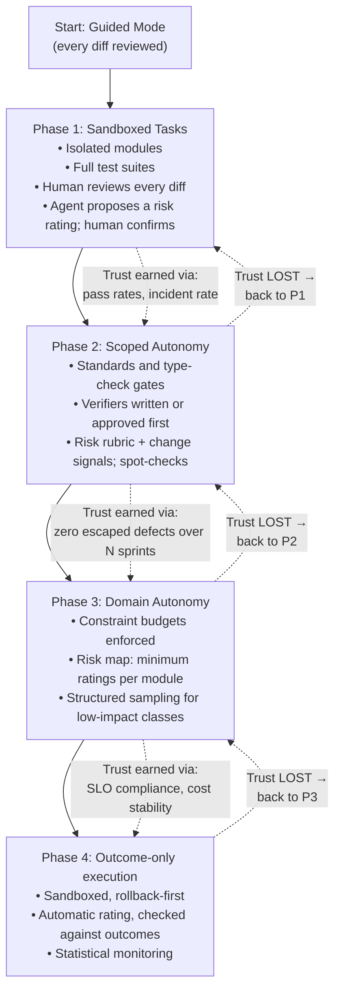

Each phase is entered by evidence, not by calendar. The practices that make it work:

1. **Human review is the default.** A class of change moves to **structured sampling** only when its impact is low, verifiers cover the outcomes that matter, enforced standards pass, and it has a record of zero escaped defects. Changes under human review stay small.
2. **Rate changes by impact and binding constraints, not size.** The rating itself is earned autonomy:
   - first the agent proposes and a human confirms, defaulting to *high* when unsure;
   - then a rubric plus deterministic change signals;
   - then minimum ratings per module, enforced by a hook;
   - finally automatic rating, checked against outcomes.

   The agent may always raise a rating; lowering it needs evidence or a human. The rater is independent of the implementing agent, because agents game their own checks [N12]. Change-level risk prediction is an established technique [N52].
3. **Verifier first.** Tests, budgets and checkers are written or approved before the agent runs, and are protected from agent edits.
4. **Constraint budgets** for performance, memory and security run in CI. A tight or breached budget means a human reads the generated code.
5. **Large migrations only as guided migrations:** implementation-agnostic tests first, in batches, each through review.
6. **The harness is a maintained product** (context files, skills, hooks, settings, verifiers), with an owner and a refinement cadence.
   - Context files do not improve success by default and add over 20% to inference cost [N15].
   - They grow mostly by small additions [N14].
   - So developers **refine the harness while prompting**: when the agent's output reveals a missing, stale, conflicting or ineffective instruction, they fix it in the same change.
7. **Preserve code-reading skill.** Use AI for inquiry, not only delegation, while learning [N2]. Treat skill atrophy and the narrowing junior pipeline as named risks.
8. **Measure review health and agent cost:** time in review, share of unreviewed merges, change size, escaped defects, and cost per task and its variance.
9. **Re-measure every 6 months**, or earlier if any of these happen:
   - METR's time horizon doubles;
   - SWE-Bench Pro rises by more than 10 pp;
   - internal eval pass rates move by more than 10 pp;
   - escaped-defect or unreviewed-merge rates move by more than 25%.

Numeric thresholds above are starting values, not evidence-based.

## 11. What the evidence does not show

The best case for the claims is strong and is acknowledged here:
- capability is growing fast [N1, N6];
- guided migrations save large amounts of time [N3, N4];
- where formal checkers exist, review can move to them [N9];
- natural-language intent can be formalised through tests [N33];
- agent code is not universally worse [C1, C2];
- adoption of agent configuration is already widespread [N35].

What remains open:
- **No cost data for claim B.** No study compares the full cost of guided regeneration with maintenance.
- **No data on harness obsolescence** or on who maintains agent configuration.
- **The Jevons effect on labour is unproven.** Total software postings are still below 2020 levels [N44].
- **The marginal rule (§9) has no direct study.** Its inputs are measurable, but nobody has measured them together.

## 12. Conclusion

The claim that "you won't need to understand code in a few years" extrapolates from the cases where agents do well and ignores those where they fail. It also overlooks the evidence that matters most: what happens to people who stop reading code, and what happens to review when output grows. With that evidence, the conclusion is:

> **Code understanding is not being eliminated, it is being concentrated.** Fewer people and fewer steps need it; where it is needed, the depth does not fall. Its job shifts from writing every line to designing the verifiers, deciding where constraints bind, diagnosing what verifiers miss, and judging whether the architecture will survive the next change.

Autonomy is an output. The process that earns it, made of verifiers, standards, sandboxes, structured sampling and progressive trust, is the actual engineering work. And because the boundary moves, it is measured again, not argued once.

---

## References

IDs match the references file.

| ID | Reference |
|---|---|
| A4-alt2 | Anthropic (2026, Mar 25). *Claude Code auto mode*. anthropic.com/engineering/claude-code-auto-mode |
| A5 | Goddard, K., Roudsari, A., & Wyatt, J. C. (2012). Automation bias: a systematic review of frequency, effect mediators, and mitigators. *JAMIA*, 19(1), 121–127 |
| B1 | Becker, J., Rush, N., Barnes, B., & Rein, D. (2025). *Measuring the Impact of Early-2025 AI on Experienced Open-Source Developer Productivity*. [arXiv:2507.09089](https://arxiv.org/abs/2507.09089) |
| B2 | METR (2026, Feb 24). *Uplift update*. [metr.org](https://metr.org/blog/2026-02-24-uplift-update/) |
| B3 | Li, X., Ben-Israel, N., Raz, Y., Ahmed, B., Serebro, D., & Raux, A. (2026). *RepoMod-Bench*. Preprint. [arXiv:2602.22518](https://arxiv.org/abs/2602.22518) |
| B4 | Huang, D., Qing, Y., Shang, W., Cui, H., & Zhang, J. M. (2024). *EffiBench*. NeurIPS 2024. [arXiv:2402.02037](https://arxiv.org/abs/2402.02037) |
| B5 | Qing, Y. et al. (2025). *EffiBench-X*. NeurIPS 2025 D&B. [arXiv:2505.13004](https://arxiv.org/abs/2505.13004) |
| B6 | GitClear (2026). *The Maintainability Gap: AI Code Quality in 2026*. [gitclear.com](https://www.gitclear.com/the_ai_code_quality_maintainability_gap) |
| B7 | Patel, S. et al. (2026). *Is Agent Code Less Maintainable Than Human Code?* [arXiv:2606.21804](https://arxiv.org/abs/2606.21804) |
| B8 | Sawada, S. et al. (2026). *To What Extent Does Agent-generated Code Require Maintenance?* EASE 2026. [arXiv:2605.06464](https://arxiv.org/abs/2605.06464) |
| B9 | Pan, R. et al. (2026). *Do Modifications Made by Coding Agents Make Subsequent Software Maintenance Harder?* Preprint. [arXiv:2610.14768](https://arxiv.org/abs/2610.14768) |
| B10 | Cummins, C. et al. (2024). *Meta Large Language Model Compiler: Foundation Models of Compiler Optimization*. [arXiv:2407.02524](https://arxiv.org/abs/2407.02524) |
| B12 | He, H., Miller, C., Agarwal, S., Kästner, C., & Vasilescu, B. (2026). *Speed at the Cost of Quality*. MSR '26. [arXiv:2511.04427](https://arxiv.org/abs/2511.04427) |
| B13 | DORA / Google Cloud (2025). *State of AI-assisted Software Development*. [dora.dev](https://dora.dev) |
| C1 | Rahman, M., & Shihab, E. (2026). *Will It Survive? Deciphering the Fate of AI-Generated Code in Open Source*. [arXiv:2601.16809](https://arxiv.org/abs/2601.16809) |
| C2 | Kraishan, O. (2026). *Not All Agents Are Equal*. [arXiv:2609.17598](https://arxiv.org/abs/2609.17598) |
| C3 | Harvey, N., & DeBellis, D. (2024, Oct 22). *Highlights from the 10th DORA report*. [Google Cloud Blog](https://cloud.google.com/blog/products/devops-sre/announcing-the-2024-dora-report) |
| C4 | GitClear (2026). *The Maintainability Gap* and *AI Coding Tools Attract Top Performers – But Do They Create Them?* [gitclear.com](https://www.gitclear.com/developer_ai_productivity_analysis_tools_research_2026) |
| C5 | Jiang, H. et al. (2025). *Can Large Language Models Understand Intermediate Representations in Compilers?* [arXiv:2502.06854](https://arxiv.org/abs/2502.06854) |
| N1 | Kwa, T., West, B., Becker, J., et al. (2025). *Measuring AI Ability to Complete Long Software Tasks*. [arXiv:2503.14499](https://arxiv.org/abs/2503.14499); METR (2026). [*Time Horizon 1.1*](https://metr.org/blog/2026-01-29-time-horizon-1-1/) |
| N2 | Shen, J. H., & Tamkin, A. (2026). *How AI assistance impacts the formation of coding skills*. Anthropic. [arXiv:2601.20245](https://arxiv.org/abs/2601.20245) |
| N3 | Nikolov, S. et al. (2025). *How is Google using AI for internal code migrations?* [arXiv:2501.06972](https://arxiv.org/abs/2501.06972) |
| N4 | Airbnb Engineering (2025). *Accelerating Large-Scale Test Migration with LLMs*. airbnb.tech |
| N6 | Deng, X., Da, J., Pan, E., et al. (2025). *SWE-Bench Pro*. [arXiv:2509.16941](https://arxiv.org/abs/2509.16941) |
| N9 | Lopes, N. P., Lee, J., Hur, C.-K., Liu, Z., & Regehr, J. (2021). *Alive2: Bounded Translation Validation for LLVM*. PLDI 2021 |
| N11 | Dijkstra, E. W. (1978). *On the foolishness of "natural language programming"* (EWD667). [cs.utexas.edu](https://www.cs.utexas.edu/~EWD/transcriptions/EWD06xx/EWD667.html) |
| N12 | May et al. (2025). *FreshBrew*. [arXiv:2510.04852](https://arxiv.org/abs/2510.04852) |
| N14 | Chatlatanagulchai et al. (2025). *Agent READMEs: An Empirical Study of Context Files for Agentic Coding*. [arXiv:2511.12884](https://arxiv.org/abs/2511.12884) |
| N15 | Gloaguen et al. (2026). *Evaluating AGENTS.md: Are Repository-Level Context Files Helpful for Coding Agents?* [arXiv:2602.11988](https://arxiv.org/abs/2602.11988) |
| N18 | Brynjolfsson, E., Chandar, B., & Chen, R. (2025, rev. 2026). *Canaries in the Coal Mine?* Stanford Digital Economy Lab (working paper) |
| N23 | Faros AI (2026). *AI Engineering Report 2026: The Acceleration Whiplash*. [faros.ai](https://www.faros.ai/blog/ai-acceleration-whiplash-takeaways) (vendor telemetry) |
| N24 | Faros AI (2025). *AI Productivity Paradox Report 2025*. [faros.ai](https://www.faros.ai/blog/ai-productivity-paradox-report-2025) (vendor) |
| N25 | GitHub (2025, Oct 28). *Octoverse 2025*. [github.blog](https://github.blog/news-insights/octoverse/octoverse-a-new-developer-joins-github-every-second-as-ai-leads-typescript-to-1/) |
| N26 | Jin, X., Larson, J., Yang, W., & Lin, Z. (2023). *Binary Code Summarization: Benchmarking ChatGPT/GPT-4 and Other LLMs*. [arXiv:2312.09601](https://arxiv.org/abs/2312.09601) |
| N27 | Mikek et al. (2026). *Agentic Code Optimization via Compiler-LLM Cooperation*. [arXiv:2604.04238](https://arxiv.org/abs/2604.04238) |
| N29 | Paul, I., Glavaš, G., & Gurevych, I. (2024). *IRCoder*. ACL 2024. [arXiv:2403.03894](https://arxiv.org/abs/2403.03894) |
| N30 | Le et al. (2025). *When Names Disappear: Revealing What LLMs Actually Understand About Code*. [arXiv:2510.03178](https://arxiv.org/abs/2510.03178) |
| N31 | Mündler, N., He, J., Wang, H., Sen, K., Song, D., & Vechev, M. (2025). *Type-Constrained Code Generation with Language Models*. PLDI 2025. [arXiv:2504.09246](https://arxiv.org/abs/2504.09246) |
| N32 | Mu, F. et al. (2024). *ClarifyGPT*. FSE 2024. [arXiv:2310.10996](https://arxiv.org/abs/2310.10996) |
| N33 | Fakhoury, S., Naik, A., Sakkas, G., Chakraborty, S., & Lahiri, S. K. (2024). *LLM-based Test-driven Interactive Code Generation*. IEEE TSE 50(9). [arXiv:2404.10100](https://arxiv.org/abs/2404.10100) |
| N35 | Galster, M. et al. (2026). *Configuring Agentic AI Coding Tools: An Exploratory Study*. AIware '26. [arXiv:2602.14690](https://arxiv.org/abs/2602.14690) |
| N41 | Anthropic Economics (2026, Jun 16). *Agentic coding and persistent returns to expertise* |
| N42 | Kononenko, O. et al. (2015). ICSME 2015; Bosu, A., Greiler, M., & Bird, C. (2015). *Characteristics of Useful Code Reviews*. MSR 2015 |
| N43 | Jost et al. (2026). [arXiv:2603.15298](https://arxiv.org/abs/2603.15298) |
| N44 | Indeed Hiring Lab (2026, Jul). Aidala & Puri; Gallacher |
| N45 | Prather, J. et al. (2024). *The Widening Gap*. ICER 2024. [arXiv:2405.17739](https://arxiv.org/abs/2405.17739) |
| N46 | Spolsky, J. (2002). *The Law of Leaky Abstractions*. joelonsoftware.com |
| N47 | Chen, T.-H. et al. (2014). *Detecting performance anti-patterns for applications developed using object-relational mapping*. ICSE 2014 |
| N48 | Kapoor, S. et al. (2024). *AI Agents That Matter*. [arXiv:2407.01502](https://arxiv.org/abs/2407.01502) |
| N49 | Brown, B. et al. (2024). *Large Language Monkeys: Scaling Inference Compute with Repeated Sampling*. [arXiv:2407.21787](https://arxiv.org/abs/2407.21787) |
| N50 | SmartBear / Cisco code review study (Cohen, ~2006). Vendor, not peer-reviewed |
| N51 | Bai et al. (2026). *How Do AI Agents Spend Your Money?* [arXiv:2604.22750](https://arxiv.org/abs/2604.22750) |
| N52 | Kamei, Y. et al. (2013). *A Large-Scale Empirical Study of Just-in-Time Quality Assurance*. IEEE TSE 39(6), 757–773. doi:10.1109/TSE.2012.70 |

---

## Changes

**v1.0 (2026-11-13)**, replacing the first version (2026-11-07). The full history, with the review behind each change, is in the accompanying discussion.

- **Sources corrected:**
  - the 2026 METR follow-up (a non-significant speedup, not a slowdown);
  - the "+441% review time" figure, now attributed to Faros AI, not DORA;
  - the LLM Compiler reference, whose link pointed to an unrelated paper;
  - the "velocity 281% → 0%" claim, now attributed to He et al. and worded as lines added;
  - RepoMod-Bench, now labelled a preprint.
- **Unverified content removed:**
  - interpolated chart values;
  - the domain quadrant and viability table;
  - the claim that "five independent research programs converge".
- **Counter-evidence added and discussed:** C1, C2, DORA 2024 and GitClear's selection finding.
- **New sections:**
  - the claims under test, with verdicts;
  - the human side (§6);
  - review being dropped (§7);
  - the marginal decision rule (§9);
  - what the evidence does not show (§11).
- **Earned-autonomy path extended:** incremental risk rating, structured sampling, verifier first, constraint budgets, and harness ownership and refinement.
- **Charts redrawn:** only figures verified on primary sources are used.

---

*Version v1.0, 2026-11-13.*
